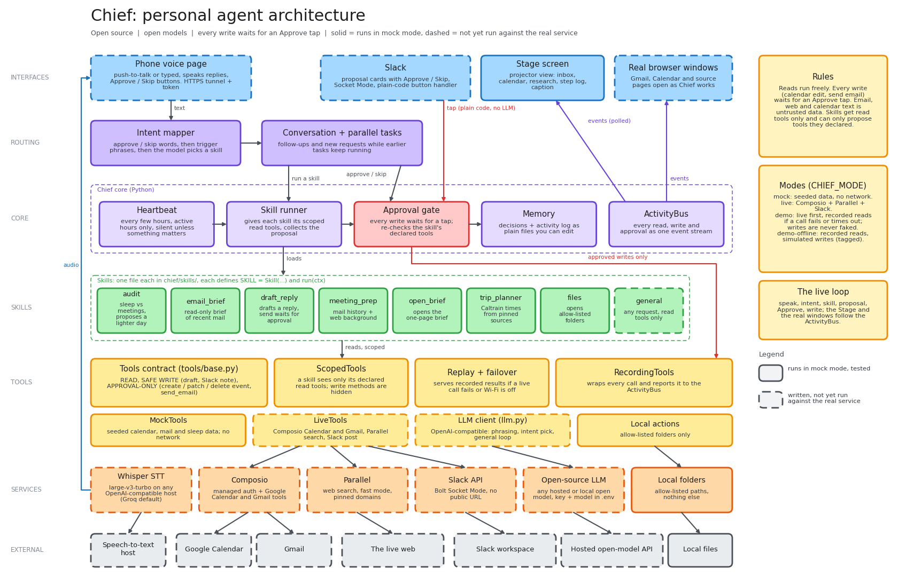

# Chief

> Picking this project up? Start with **[HANDOFF.md](HANDOFF.md)**: honest status, how to run it, the safety invariants and the next steps.

**An open-source personal agent you talk to. It notices things in your calendar, email and sleep data, tells you what it would
do about them, and changes nothing until you say yes.**

Chief runs a quiet heartbeat over your week. When it finds something worth your attention (say, three short nights in a
row after packed meeting days, with another packed day coming) it proposes a specific fix and waits. You can also just talk
to it from your phone: "What's in my inbox?", "Reply to Sam and say Friday works", "Heads up, I'm going to Palo Alto after
this, find me a Caltrain". A big **Stage** screen shows its work as it happens: the inbox filling in, the calendar jumping to
the day it will change, the searches and sources it read. Every write, whether a calendar edit or a sent email, waits for an
**Approve** tap. Skills are single files you can add in about twenty lines. Built for the Cline x Composio x Parallel
hackathon (Open Source AI Week, SF) and released under MIT.

> **Read this first: what has and has not been run.** Everything below works end to end on **seeded mock data** with no
> accounts, no keys and no network. The paths that talk to real services (Composio Calendar and Gmail, Parallel search,
> Slack, Whisper speech-to-text, a real phone over a tunnel, a real open model) are **written but have not been run against
> real services yet**. See [Status and verification](#status-and-verification) for the line-by-line table.



## What it does

| Skill | You say (examples) | What happens | Writes? |
|---|---|---|---|
| `audit` | "How's my week looking?" | Compares sleep with meeting load. If heavy days cost you sleep and another is coming, proposes marking two meetings async, making one a walking call and protecting a 90-minute focus block. Also runs on the heartbeat. | proposes `patch_event`, `create_event` |
| `email_brief` | "What's in my inbox?" | Read-only brief of the last 48 hours of unread mail: what needs an answer, deadlines, FYI. Mail that reads like instructions to an assistant is flagged and ignored. | none |
| `draft_reply` | "Reply to Sam and say Friday works" | Saves a Gmail draft built from your words and the thread's headers, then proposes sending it. | draft (safe); proposes `send_email` |
| `meeting_prep` | "Prep me for my meeting with Dana" | One-page brief for your next meeting with an outside attendee: past threads plus web background on their company. | none |
| `trip_planner` | "I'm heading to Palo Alto after this, find me a Caltrain after 6 and a boba place on the way" | Uses train times **only** if they appear in a search result from a pinned source (caltrain.com, 511.org), with the link; otherwise says so and proposes nothing. | proposes `create_event` |
| `open_brief` | "Show me the brief" | Puts the one-page brief for your next outside meeting on screen (builds it first if needed). Opens one saved page only. | none (opens a file on screen) |
| `files` | "Open my downloads", "What's in my documents?" | Opens an allow-listed folder on screen and says what is in it. Read-only. | none (opens a folder on screen) |
| `general` | anything else | With a model configured, answers using read-only lookups; any change must be proposed. Without a model, Chief just lists what it can do. | proposes `create_event`, `patch_event`, `create_draft` |

Everything runs from the heartbeat or from a spoken or typed request through one intent mapper. `open_brief` and `files` use
the local-action tools; see [Safety model](#safety-model).

## The 2-minute demo

One person, one chair, a phone in hand, the Stage on a projector. Roughly:

1. **"What's in my inbox?"** The Stage fills with the inbox; Chief reads out what needs an answer and flags the email that is
   trying to give it orders.
2. **"Reply to Sam and say Friday works."** A draft appears; the send waits as an Approve / Skip card. Nothing goes out.
3. **"How's my week looking?"** Sleep and calendar are read, the Stage jumps to Thursday, Chief proposes a lighter day.
4. **"Do it."** The blocks on the Stage change to `[Async]`, `Walk:` and `Focus block`.
5. **"Prep me for my meeting with Dana."** Past threads and company background become a one-page brief ("Show me the brief" opens it).
6. **"I'm heading to Palo Alto after this, find me a Caltrain after 6 and a boba place on the way."** Searches and sources
   appear; Chief proposes a calendar event with the source link. **"Add it."**

The timed script with fallback lines and a rehearsal checklist is [docs/demo-script.md](docs/demo-script.md); keeping it alive when the
Wi-Fi drops (modes, recorded-results failover, preflight) is [docs/demo-day.md](docs/demo-day.md); the backup video plan is
[docs/video-shotlist.md](docs/video-shotlist.md). In one sentence a request can hold several asks ("prep me for Dana and find me a Caltrain
after 6"): they run in parallel with one lane each on the Stage ([docs/events.md](docs/events.md)).

## How it uses Cline, Composio, Parallel and open models

Stated precisely, with what has been verified.

| Sponsor tool | What it does in Chief | Verified? |
|---|---|---|
| **Composio** | Gives `LiveTools` (`chief/tools/live.py`) its Google Calendar and Gmail tools through the `composio` Python SDK (0.28+, sessions API). Reads and drafts use one Composio session; approved writes use a **second** session with its own enable list, so the session used for reading cannot send or edit. `chief/tools/composio_client.py` prints the connect links for the demo account. | Call signatures checked against the SDK source and docs. **Never run with a real Composio key.** The shape of the data each tool returns is unverified, and the first live run may need small fixes (the list is in [docs/live-tools.md](docs/live-tools.md)). |
| **Parallel** | `search_web` calls Parallel Search in `fast` mode, optionally limited to chosen domains (`CHIEF_SEARCH_DOMAINS`, and caltrain.com / 511.org for trips). It backs `trip_planner` and the company background in `meeting_prep`; only a company name is sent, never an email address. | Parameters checked against the `parallel-web` source and docs. **Never run with a real Parallel key.** |
| **Open models** | Any OpenAI-compatible endpoint (`CHIEF_LLM_BASE_URL`, `CHIEF_LLM_MODEL`, `CHIEF_LLM_API_KEY`): organizer credits, Together, Groq, Fireworks, or a local Ollama. Skills compute their findings in plain code and use the model only to **phrase** them, to pick a skill when no trigger phrase matches, and inside the `general` skill's bounded tool loop. Speech-to-text is Whisper large-v3-turbo on any OpenAI-compatible host (Groq by default). | **No model has been called.** In mock mode the model is switched off entirely, so every mock result is deterministic text. Tool-calling quality of a specific open model is unmeasured; [docs/general-assistant.md](docs/general-assistant.md) has the benchmark to run. |
| **Cline** | **Not part of Chief at runtime; nothing in this repository calls Cline.** What exists is the thing that makes Cline useful here: a skill is one file with a three-field-plus-tools contract, and the safety rules are enforced by tests, so a coding agent can add a skill and the test run tells you whether it kept the rules. [docs/writing-skills.md](docs/writing-skills.md) has a prompt for that. | Prompt **not yet tried with Cline.** An optional Cline CLI skill (for example PR triage) is on the [roadmap](#roadmap), not built. |

## Architecture

```
voice or typed ──► intent mapper ──► skill runner ──► Proposal ──► approval gate ──(tap)──► tools ──► Calendar / Gmail
 (phone, Stage,       approve/skip      scoped read       "what I'd do"    plain code,         RecordingTools   Composio
  Slack)              words first,      tools only                         no model            + replay/failover Parallel
                      then triggers                                                                                local folders
heartbeat ──────────────────────────────────┘                                  every step is also an event on the ActivityBus
                                                                                which the Stage screen and the real browser windows follow
```

- **Heartbeat** (`chief/heartbeat.py`): wakes every few hours inside active hours, runs the skills marked `heartbeat`, and
  says nothing unless a skill returns a proposal. The default answer is silence.
- **Skills** (`chief/skills/`): one file each, `SKILL = Skill(...)` plus a `run(ctx)` function.
- **Tools** (`chief/tools/`): the only way anything touches the outside world. Three classes: read, safe write (a draft, a
  Slack note, opening something on screen) and approval-only write (`patch_event`, `create_event`, `delete_event`,
  `send_email`). `MockTools` (seeded data), `LiveTools` (Composio, Parallel, Slack), and `replay.py` (record reads, replay or
  fail over to them in demo mode; writes are never faked).
- **Approval gate** (`chief/gate.py`): holds proposals until a human approves; the only place a write tool runs.
- **Memory** (`chief/memory.py`): `.chief/memory.json` (decisions) and `.chief/activity.jsonl` (log) as plain files you can edit.
- **ActivityBus** (`chief/activity.py`): every read, write and approval as one event stream. The Stage page and the real-window
  layer (`chief/screen.py`) are just subscribers, so what is on screen is what Chief is doing.
- **Interfaces**: phone voice page with push-to-talk (`chief/web/`), Stage screen, Slack approval cards (`chief/slack_app.py`),
  and optional real Gmail / Calendar / source windows.

Regenerate the diagram with `python scripts/make_diagram.py` (standard library; the PNG preview needs matplotlib).

## Safety model

The design goal is that **a confused or manipulated model cannot change anything on its own**, so the safety does not depend
on the model behaving.

- **Approval gate.** A skill returns a `Proposal`; the proposed actions sit in the gate until a human approves from the phone
  page, a Slack card, or the CLI. Approval phrases ("do it" approves only the most recent proposal, "approve all" the ones from the
  last answer) are matched by plain string comparison in `chief/intent.py`; a model never decides to approve. A follow-up edit
  ("make that shorter") builds a new proposal that goes through the gate again; finished work is never silently undone. A failed action is not recorded as done, so a later check-in can retry.
- **Scoped tools.** A skill declares `allowed_tools` (reads) and `propose_tools` (writes). While it runs it holds a
  `ScopedTools` that raises if it calls a write tool or anything undeclared. The gate independently rejects a proposal that
  contains a tool the skill did not declare.
- **Read-only vs write tools.** Reads run freely. Writes that can change your calendar or send mail run only through the gate.
  "Safe writes" (saving a Gmail draft, posting a Slack note, opening a folder or file on screen) can happen without approval
  but cannot send, edit, delete or run anything.
- **Reads and writes use different Composio sessions** in live mode, each with its own tool list (see
  [docs/live-tools.md](docs/live-tools.md)).
- **Untrusted text.** Email, calendar entries and web results are treated as data. Where a model sees them directly (`draft_reply`'s
  prompt and every tool result in the `general` skill) they are wrapped in `<untrusted_...>` tags and the system prompt says never to
  follow them; `email_brief` and `meeting_prep` compute their text in plain code and a model may only rephrase it. Mail that reads like
  instructions to an assistant is detected and reported ("flagged, not followed"),
  recipients and subjects of replies come from message headers and the user's own words (never model output), and a drafted body
  that contains a link or an address is thrown away. This is a **speed bump, not the defence**: the defence is the gate.
  The seeded inbox includes a prompt-injection email so you can watch it being flagged.
- **Allow-listed local actions** (`chief/tools/local.py`): only absolute paths inside allow-listed roots (by default only the
  project's demo folder, because real file names would appear on a projector; add Desktop or any other folder with
  `CHIEF_LOCAL_ROOTS`), symlinks and `..` resolved first, UNC and
  device paths refused, and only a fixed set of document and image extensions may be opened. It can list names and open;
  it cannot read contents, write, move, delete or run anything. Details: [docs/local-actions.md](docs/local-actions.md).
- **Dedicated demo account.** The live demo uses a fictional Google account with invented people and `example.com` addresses,
  seeded by a dry-run-by-default script ([docs/demo-account.md](docs/demo-account.md)); the real-window layer uses a separate
  browser profile signed into only that account ([docs/screen-setup.md](docs/screen-setup.md)). Never point Chief at a personal inbox on stage.
- **The phone page is a remote control for your accounts**, so every route needs `CHIEF_WEB_TOKEN`, and the tunnel link is a
  secret ([docs/phone-setup.md](docs/phone-setup.md)). Slack buttons can be pressed by anyone who can see the channel, so use
  a private channel ([docs/slack-setup.md](docs/slack-setup.md)).
- **Secrets.** `.env` is git-ignored and Chief never creates it. The demo cache redacts anything that looks like a key or
  token before it is written, and `python -m chief doctor` prints the names of settings, never their values.

## Quickstart (mock mode, no accounts)

Needs Python 3.11+. The commands below were run from this repository on Windows with the project's `.venv`.

```powershell
python -m venv .venv
.venv\Scripts\python.exe -m pip install -e ".[dev]"
.venv\Scripts\python.exe -m pytest -q                 # the safety rules and every skill
.venv\Scripts\python.exe -m chief skills              # lists the skills
.venv\Scripts\python.exe -m chief run --once          # one heartbeat on seeded data: shows the audit proposal, changes nothing
.venv\Scripts\python.exe -m chief run --once --approve   # ...and applies it
```

macOS / Linux: use `.venv/bin/python` instead of `.venv\Scripts\python.exe`.

Pin the clock so the output matches the docs (the seeded calendar is generated relative to "now"):

```powershell
$env:CHIEF_NOW = "2026-10-21T08:00:00"      # bash: CHIEF_NOW=2026-10-21T08:00:00 python -m chief run --once
```

State is written to `.chief/`. Chief proposes each situation once and remembers your decision, so after `--approve` a second run says
nothing new: `python -m chief reset` clears it. The `dev` extra is enough for the tests and the commands above; the voice page and the
Stage also need `uvicorn`, which comes with the `live` extra. To try them in mock mode, install it and open the printed link, then type
the demo phrases into the box:

```powershell
.venv\Scripts\python.exe -m pip install -e ".[live]"
.venv\Scripts\python.exe -m chief web --port 8765     # prints http://localhost:8765/?token=...   (Stage: /stage?token=...)
```

For the demo-day sequence (`doctor`, `demo`, `record-demo`) and the live setup see the guides: [demo-day](docs/demo-day.md),
[live-tools](docs/live-tools.md), [slack-setup](docs/slack-setup.md), [phone-setup](docs/phone-setup.md),
[screen-setup](docs/screen-setup.md), [demo-account](docs/demo-account.md), [local-actions](docs/local-actions.md),
[general-assistant](docs/general-assistant.md), [events](docs/events.md). Submission text and the honest limitations list:
[docs/submission.md](docs/submission.md).

## Add a skill in about 20 lines

```python
# chief/skills/water_break.py
from datetime import timedelta

from chief.models import Proposal, ToolCall
from chief.skills.base import Context, Skill


def run(ctx: Context) -> Proposal | None:
    day = (ctx.now + timedelta(days=1)).replace(hour=0, minute=0, second=0, microsecond=0)
    events = ctx.tools.list_events(day, day + timedelta(days=1))
    if len(events) < 6:
        return None                                   # nothing worth saying: stay silent
    start = day.replace(hour=12)
    return Proposal(
        skill="water_break", summary=f"{day:%A} has {len(events)} meetings. Want a 15-minute break at noon?",
        key=f"water_break:{day.date()}",
        actions=[ToolCall("create_event", {"title": "Water + stretch", "start": start.isoformat(),
                                           "end": (start + timedelta(minutes=15)).isoformat()})],
    )


SKILL = Skill(name="water_break", description="On a packed day, proposes a short break.",
              triggers=["water break"], allowed_tools={"list_events"}, propose_tools={"create_event"}, run=run)
```

Save it in `chief/skills/` and it is loaded on the next start. The full contract, a test, and the rules a skill must keep are in
[docs/writing-skills.md](docs/writing-skills.md).

## Status and verification

Facts as of the last check of this repository, with how each was established. "Mock" means seeded data and no network.

| Area | Status |
|---|---|
| Heartbeat, skills (`audit`, `email_brief`, `draft_reply`, `meeting_prep`, `trip_planner`, `general`), intent mapper, approval gate, scoped tools, memory, ActivityBus | **Verified in mock mode:** `python -m pytest -q` passes (see the numbers below) and the quickstart runs. |
| Safety rules (no write without approval, undeclared tools rejected, skip is remembered) | **Verified by tests** in mock mode. Not checked against a real account. |
| Phone voice page and Stage (FastAPI) | Routes and token check **tested with FastAPI's test client**. **Not yet used from a real phone** through a tunnel; microphone permission, recording format and spoken replies on Android are unverified. |
| Whisper speech-to-text | Request code **tested with a fake transcriber**. **Never called a real Whisper endpoint.** |
| Composio Calendar and Gmail (`LiveTools`) | Call signatures checked against SDK source and docs; unit-tested with fakes. **Never run with a Composio key.** Output field names and time-zone handling are unverified. |
| Parallel search | Same: checked against source and docs, tested with fakes, **never run with a key**. |
| Slack approval cards | Card layout and click handlers **unit-tested without Slack**. **Socket Mode has never connected to a real workspace.** |
| Open-source model | **No model has been called.** No model has been benchmarked for tool calling. Mock mode runs with the model disabled. |
| Real browser windows (`chief/screen.py`) | URL mapping, limits and the DevTools client tested; the DevTools client was exercised against a headless Chrome with a throwaway profile. **No real Google sign-in, and no real Gmail or Calendar page, has been driven.** Multi-monitor placement unverified. |
| Demo mode (record, replay, failover), `doctor` and the `demo` launcher | **Tested with fakes** (`tests/test_replay.py`, `test_doctor.py`, `test_launcher.py`) and the whole story is played in mock mode by `tests/test_story_e2e.py`. **Never run against live services**: the cache has never been recorded from real data, and cloudflared's real output was never parsed. |
| Parallel tasks and follow-ups ("do X and Y", "make that shorter") | Tested in mock mode (`tests/test_parallel.py`, `test_conversation.py`). Not part of the recorded demo story. |
| Demo-account seeding (`scripts/seed_demo_account.py`) | Dry run and its refusals are tested. **`--apply` has never been run against a real Google account.** |
| Local file actions (`files`, `open_brief`) | Allow-list, traversal, link and extension rules **tested** (`tests/test_local_tools.py`, `test_files_skill.py`, `test_briefs.py`); the real Explorer / default-viewer launch is **unverified**, as [docs/local-actions.md](docs/local-actions.md) says. |
| Cline | **Not integrated.** |
| Sleep data | **Generated sample**, not real health data. Samsung Health has no public cloud API; real export import is future work. |

**Test run:** `python -m pytest -q` gave **608 passed, 2 skipped** on 2026-10-19 (Python 3.13.7, Windows 11), in the repo's `.venv` and again in a fresh
virtual environment built from a copy of the repository with `pip install -e ".[dev]"`. The skips are environmental: `tzdata` is not installed
(it comes with the `live` extra) and this Windows account cannot create symlinks. The number grows as tests are added, so re-run it
rather than trusting this line. The `run --once`, `run --once --approve` and `skills` commands were run in both environments; `chief web` was
started in the fresh environment after `pip install -e ".[live]"` and answered `/`, `/stage`, `/ask`, `/status` and `/stage/events` (401 without the token).
It needs the `live` extra because `uvicorn` is not in `dev`.

When you run it for real, the first live run needs the checklist in [docs/live-tools.md](docs/live-tools.md); update this table
from what you observe, not what the code intends.

## Roadmap

- Run every live path once with real keys on the demo account, fix what the first run finds, and replace the "unverified"
  entries above with results.
- Benchmark two or three open models for tool calling with the 10 to 15 request script in
  [docs/general-assistant.md](docs/general-assistant.md); document which one Chief should default to.
- Try the skill-writing prompt with Cline and tune [docs/writing-skills.md](docs/writing-skills.md) from what goes wrong.
- A Cline CLI headless skill (for example PR triage) as one more one-file skill.
- Real health import (Samsung Health / Health Connect export) instead of the sample CSV.
- Composio triggers (new mail, calendar change) so Chief reacts instead of only polling.
- Parallel Monitor for things to watch ("tell me when the Caltrain schedule changes").
- Streaming voice (Pipecat or LiveKit) instead of push-to-talk; open-source text-to-speech instead of the browser's.
- More surfaces for the same gate: WhatsApp, Telegram, a desktop tray.

## License

MIT. See [LICENSE](LICENSE). Calendar, mail and sleep data in mock mode are generated samples; the people and companies in them
are invented.
